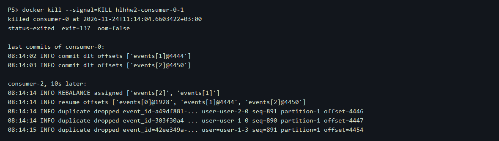
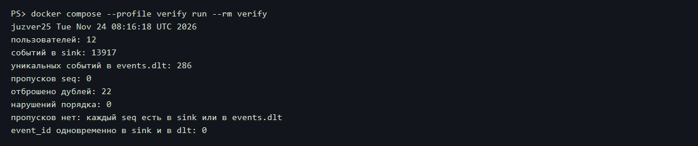
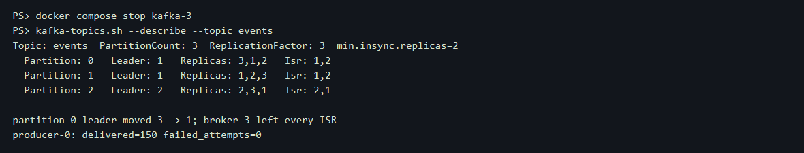
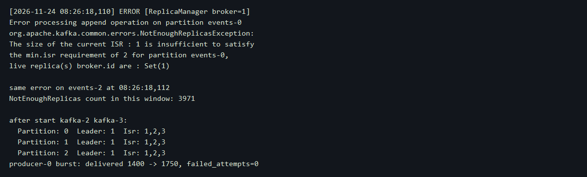
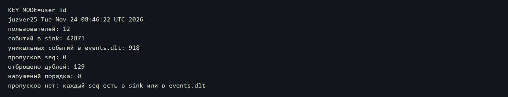
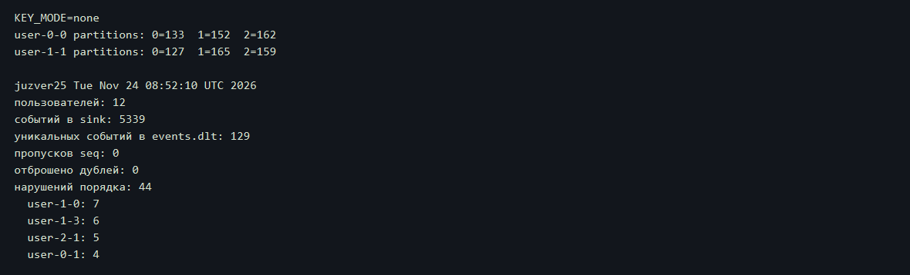

# Kafka: продюсеры, at-least-once и ядовитые события

GitHub: [juzver25/HW-2](https://github.com/juzver25/HW-2)

Три брокера Kafka в режиме KRaft, три продюсера и группа `events-processor` из трёх консьюмеров. Консьюмер пишет результат в Postgres и коммитит оффсет только после успешной записи. Около 2% событий ядовитые: после трёх ошибок они уходят в `events.dlt`.

## Запуск

```powershell
docker compose up --build -d
docker compose ps
docker compose --profile verify run --rm verify
```

Перед `verify` остановите продюсеры и дождитесь, пока консьюмеры дочитают хвост, иначе последние `seq` ещё не попадут в sink и скрипт покажет их как пропуски:

```powershell
docker compose stop producer-0 producer-1 producer-2
Start-Sleep -Seconds 15
docker compose --profile verify run --rm verify
docker compose start producer-0 producer-1 producer-2
```

С хоста брокеры доступны как `localhost:19092`, `localhost:19093`, `localhost:19094`. Из сети compose — `kafka-1:9092,kafka-2:9092,kafka-3:9092`.

Полезные команды:

```powershell
docker compose logs -f consumer-0
docker compose exec kafka-1 /opt/kafka/bin/kafka-topics.sh --bootstrap-server kafka-1:9092 --describe --topic events
```

Остановить и стереть данные: `docker compose down -v`.

Повторный прогон без ключа сообщения:

```powershell
docker compose down -v
$env:KEY_MODE = "none"
docker compose up -d
```

Пустое значение или отсутствие переменной означает `KEY_MODE=user_id`.

## Модель события

Каждый под-продюсер владеет своим набором `user_id` (`user-<pod>-<n>`). Порядковый номер `seq` этого пользователя растёт только в этом поде, с 1 и без пропусков. Номер сохраняется в volume, поэтому перезапуск пода не начинает последовательность заново.

```json
{
  "event_id": "uuid",
  "user_id": "user-0-1",
  "type": "page_view",
  "seq": 12,
  "produced_at": "2026-11-24T07:40:00+00:00",
  "payload": {"producer_id": "0", "poison": false}
}
```

`type` — одно из `page_view`, `add_to_cart`, `purchase`. Поле `payload.poison` равно `true` примерно у 2% событий. Для консьюмера такое событие всегда ошибка.

## Кластер

Три узла `apache/kafka:4.1.1` совмещают роли broker и controller, ZooKeeper нет. У каждого узла три listener:

| Listener | Зачем | Пример для kafka-1 |
| --- | --- | --- |
| `INTERNAL` | другие контейнеры и репликация | `kafka-1:9092` |
| `EXTERNAL` | CLI с хоста | `localhost:19092` |
| `CONTROLLER` | кворум KRaft | `kafka-1:9093` |

`advertised.listeners` отдаёт клиенту тот адрес, с которого клиент реально достучится до брокера. Heap ограничен `-Xms384m -Xmx384m`. Каталог данных — volume, и он создаётся от root, поэтому брокер запущен как `user: "0:0"`: иначе форматирование KRaft-хранилища падает с `AccessDeniedException`.

`auto.create.topics.enable=false`. Топики создаёт одноразовый сервис `kafka-init`:

| Топик | Партиции | RF | min.insync.replicas |
| --- | --- | --- | --- |
| `events` | 3 | 3 | 2 |
| `events.dlt` | 3 | 3 | 2 |

`min.insync.replicas=2` стоит и на брокере, и на топике `events`. Вместе с `acks=all` запись подтверждается, только если её приняли минимум две реплики из ISR.

## Продюсеры

Три сервиса `producer-0..2`. Настройки клиента: `acks=all`, `enable.idempotence=true`, `max.in.flight.requests.per.connection=5`. Ошибка доставки пишется в лог, а то же самое сообщение (тот же `event_id` и `seq`) ставится в повтор. На `SIGTERM` процесс перестаёт генерировать новые события и делает `flush`, чтобы ушёл буфер.

`KEY_MODE=user_id` — ключ сообщения равен `user_id`, партиционер `murmur2`: все события пользователя попадают в одну партицию. `KEY_MODE=none` — ключа нет, партиционер выбирает партицию случайно.

## Консьюмеры

Группа `events-processor`, поды `consumer-0..2`. Обработка обычного события — пауза `PROCESSING_DELAY_MS` (50 мс) и запись в Postgres.

В `processed_events` сохраняются `user_id`, `seq`, `event_id`, номер пода (`processor_id`), топик, партиция и оффсет. Первичный ключ — `event_id`. Повторная вставка не меняет строку и увеличивает `dedup_stats.dropped_duplicates`.

Автокоммит выключен. Оффсет успешно обработанных событий коммитится пачкой раз в `COMMIT_INTERVAL_MS` (8 с), при ребалансе в `on_revoke` и при `SIGTERM`. Коммит содержит только оффсеты, для которых запись в sink уже прошла. Это at-least-once: `kill -9` не вызывает `on_revoke`, поэтому события последнего интервала приходят повторно и отсекаются дедупликацией.

Ядовитое событие три раза завершается ошибкой, затем публикуется в `events.dlt` с заголовками `error-reason`, `original-topic`, `original-partition`, `original-offset`. Оффсет исходной партиции коммитится сразу после успешной отправки в DLT, чтобы яд не блокировал партицию.

`auto.offset.reset=earliest`. На первом старте у группы ещё нет коммита, а продюсеры уже пишут в топик. `latest` пропустил бы этот хвост. После первого коммита настройка больше не используется, пока коммит группы не протухнет.

Стратегия назначения — `cooperative-sticky`: при ребалансе под отдаёт только те партиции, которые у него забирают, и перед этим коммитит уже обработанные оффсеты.

## verify

`verify.py` первой строкой печатает `GITHUB_LOGIN` и вывод `date`. Дальше:

- для каждого `user_id` нет пропусков `seq` от 1 до максимального; номер, которого нет в sink, не считается потерей, если событие есть в `events.dlt`;
- сколько повторных доставок отбросила дедупликация (`dedup_stats`);
- сколько раз событие с меньшим `seq` было записано в sink позже события с большим `seq` (пары-инверсии по `processed_at`).

## Эксперименты

Продюсеры перед каждым `verify` остановлены, консьюмеры дочитывают хвост. Первая строка скрипта — логин и `date` внутри контейнера (UTC).

### 1. `kill -9` одного консьюмера

**Гипотеза.** `kill -9` не вызывает `on_revoke`, поэтому оффсеты, уже записанные в sink, но ещё не закоммиченные, будут прочитаны другим подом заново. Группа перебалансируется примерно через `session.timeout.ms` (10 с), новый владелец начнёт с последнего коммита, а не с начала партиции. Потерь не будет: пропуски `seq` закроет либо sink, либо `events.dlt`. Дубли увеличит счётчик дедупликации. Порядок пользователя не сломается, потому что ключ — `user_id` и партиция одна.

**Что произошло.** У `consumer-0` последние коммиты перед сигналом были `events[1]@4444` и `events[2]@4450` (это коммиты после ядовитых событий, они фиксируют уже обработанный префикс). Процесс завершился с кодом 137. Через 10 секунд `consumer-2` получил обе партиции и продолжил ровно с этих оффсетов. События, записанные в Postgres после коммита, пришли повторно: в логе `duplicate dropped`, счётчик вырос.

`verify` сразу после эксперимента:

```
juzver25 Tue Nov 24 08:16:18 UTC 2026
пользователей: 12
событий в sink: 13917
уникальных событий в events.dlt: 286
пропусков seq: 0
отброшено дублей: 22
нарушений порядка: 0
```

Расхождения с гипотезой нет. 22 дубля — это хвост между коммитом и `kill -9`, а не вся партиция.





### 2. Остановка брокеров

**Гипотеза.** Пока живы две реплики из трёх, `acks=all` и `min.insync.replicas=2` позволяют писать. Если лидером партиции был остановленный брокер, лидер сменится. После остановки второго брокера в ISR остаётся один узел, и лидер отвергает запись: `NotEnoughReplicas`. Продюсер не проглатывает ошибку, а повторяет отправку. Консьюмеры теряют координатора группы и уходят в ребаланс. Когда оба брокера возвращаются, ISR снова `1,2,3`, отложенные записи доезжают, пропусков `seq` нет.

**Что произошло.** До остановки контроллер — узел 1, `LeaderEpoch: 1`. После `docker compose stop kafka-3` у партиции 0 лидер сменился с 3 на 1, из всех ISR пропал брокер 3 (`Isr: 1,2`). Продюсеры при этом продолжали получать ack (`failed_attempts=0`).

Затем остановлен `kafka-2`. На `kafka-1` брокер записал отказ append:

```
[2026-11-24 08:26:18,110] ERROR [ReplicaManager broker=1] Error processing append operation on partition events-0
org.apache.kafka.common.errors.NotEnoughReplicasException: The size of the current ISR : 1 is insufficient to satisfy the min.isr requirement of 2 for partition events-0
```

Таких отказов за окно было 3971. Продюсер логировал таймаут запроса и ошибку клиента, локальный буфер не выбрасывал. Консьюмер потерял координатора (`Broker: Coordinator not available`) и отозвал назначение. После `docker compose start kafka-2 kafka-3` ISR всех партиций снова `1,2,3`, а продюсер одним залпом дописал накопленное (`delivered` скачком вырос на сотни, `failed_attempts` остался 0).

`verify` после восстановления:

```
juzver25 Tue Nov 24 08:46:22 UTC 2026
пропусков seq: 0
отброшено дублей: 129
нарушений порядка: 0
событий в sink: 42871
уникальных событий в events.dlt: 918
```

Потерь нет. Дублей стало больше, чем после эксперимента 1 (22 → 129): пока координатор был недоступен, группа ребалансировалась, и at-least-once повторно доставил уже записанные события. Это не расхождение с гипотезой, а её продолжение на консьюмерах.





### 3. `KEY_MODE=none`

**Гипотеза.** С ключом `user_id` все `seq` одного пользователя лежат в одной партиции и один консьюмер пишет их в sink по порядку, поэтому инверсий нет (эксперименты 1 и 2 это подтвердили: `нарушений порядка: 0`). Без ключа партиционер `murmur2_random` раскладывает сообщения по трём партициям. Их читают разные поды, и событие с большим `seq` может быть записано раньше меньшего. Пропусков при этом не будет: каждый `seq` по-прежнему генерирует один под и либо попадает в sink, либо в DLT.

**Что произошло.** Свежий кластер с `KEY_MODE=none`. У `user-0-0` события разъехались по всем партициям: 133 / 152 / 162. `verify`:

```
juzver25 Tue Nov 24 08:52:10 UTC 2026
пользователей: 12
событий в sink: 5339
уникальных событий в events.dlt: 129
пропусков seq: 0
отброшено дублей: 0
нарушений порядка: 44
```

Инверсии есть у всех 12 пользователей (от 1 до 7 пар). Для сравнения, тот же скрипт на прогоне с ключом `user_id` печатал `нарушений порядка: 0`.

Инверсий не тысячи, потому что один пользователь эмитится примерно два раза в секунду, а обработка занимает 50 мс: следующий `seq` часто ещё не создан, когда предыдущий уже в sink. Нарушение появляется, когда два его события одновременно лежат в разных партициях — например, одно ждёт тройную ошибку poison, а другое на свободной партиции записывается сразу.




